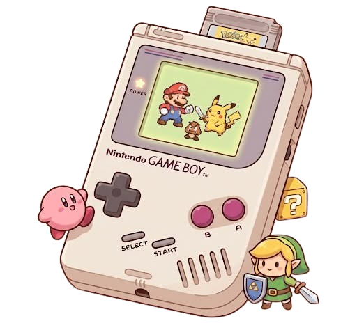

<h2 align="center"> Hello World! I'm Guilherme</h2>

<h3 align="center">Game &amp; Mobile Developer</h3>

  

  In development, I value the balance between speed and quality. I prefer to ensure the final user experience over delivering an unstable product.

<h2 align="center">🚀 About Me</h2>

  <b>Guilherme</b> here. I'm a developer focused on <b>games</b> and <b>mobile applications.</b>

  I like working on a variety of projects, from games to apps, and I am constantly evolving, learning, and improving my understanding of how to build real softwares.

  Currently, I am studying <b>Godot, Kotlin, and Python</b>, while improving my problem-solving skills with <b>Data Structures and Algorithms</b>.

  My goal is simple: write clean code, build reliable software, and become a developer who creates products that last. I am open to collaborations 👥 and available for opportunities and freelance projects. 🔧

 

<h2 align="center">🤝 Connect</h2>

  
  
  

 

<h2 align="center">💻 Tech Stack</h2>

  

  

  

